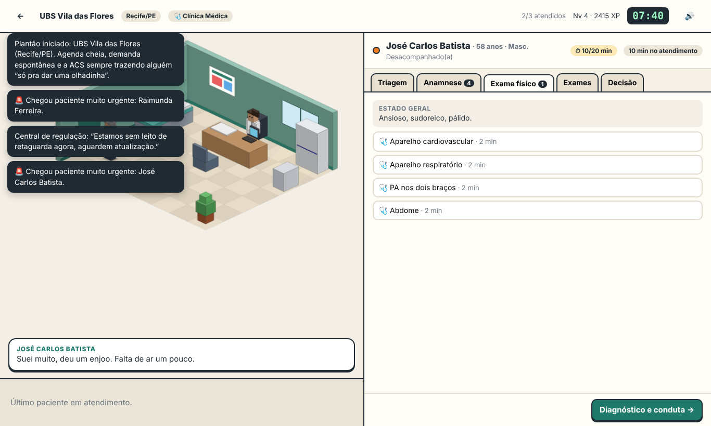

# 🩺 Plantão

A browser game for physicians. You take shifts at primary care clinics (UBS), urgent care centers (UPA), hospitals and pediatric ICUs across Brazil. Patients arrive with a triage note and tell their story the way real patients do: they forget drug names, downplay pain, or the grandmother does all the talking. You decide what to ask, examine and order, then commit to a diagnosis and a plan, and call the next patient.

The game text is in **Brazilian Portuguese** on purpose: the target audience is physicians working in Brazil's public health system (SUS). Code, docs and commits are in English.



> **Source-available, view-only.** Copying, modifying, redistributing and commercial use are not allowed. See [LICENSE](LICENSE).

## What's in v0.1

- **3 specialties:** internal medicine, general pediatrics and pediatric ICU.
- **5 units:** UBS (Recife/PE), UPA 24h (Belém/PA), general hospital (Belo Horizonte/MG), children's hospital (Curitiba/PR) and PICU (Porto Alegre/RS). Each unit only offers the tests it would realistically have. At a UBS, for example, lab results only come back at the follow-up visit.
- **23 clinical cases** based on published guidelines (Brazilian Ministry of Health, SBP, SBC, SBPT, SBD, GINA, ISPAD, Surviving Sepsis Campaign, AES/ILAE and others). Every case lists its references.
- **Shift simulation:** Manchester triage priorities, staggered arrivals and a game clock. Lab and imaging tests take time, so the patient goes to the waiting room and comes back when results are ready. Random events happen too (lab analyzer down, no beds available).
- **Continuity of care:** follow-up visits with tests the patient brings, specialist counter-referral letters and handoff notes from the previous doctor.
- **Scoring and rewards:** stars per encounter, XP, 8 levels (from intern to head of shift), 11 achievements and unlockable units. Penalties for unnecessary tests (Choosing Wisely), waits beyond the triage target, missed time-critical windows and harmful management.
- **Simplified 3D look:** a low-poly isometric scene drawn in code on Canvas 2D, with no external assets.
- **Synthesized sound:** WebAudio only (queue call chime, PICU monitor, right/wrong, achievement).
- No dependencies: HTML, CSS and ES modules.

## Running

```bash
python3 -m http.server 8080   # or any static file server
# open http://localhost:8080
```

ES modules don't load over `file://`, so you need a server.

## Tests

```bash
npm run validate   # clinical case integrity checks; also fails if docs/REFERENCES.md is out of date
npm run references # rebuild docs/REFERENCES.md after changing a case's references or diagnosis
npm run test:e2e   # plays every shift in headless Chromium (requires Playwright)
```

## Layout

```
index.html, styles.css
src/
  main.js               # screens: menu, shift, patient chart, feedback
  data/catalog.js       # tests, units, specialties, Manchester triage
  data/cases/*.js       # cases per specialty
  game/encounter.js     # encounter state and scoring
  game/shift.js         # shift: queue, clock, pending tests, random events
  game/progress.js      # XP, levels, achievements, save (localStorage)
  render/iso.js         # low-poly isometric renderer
  audio/sfx.js          # synthesized sounds
  ui/dom.js             # DOM helpers
tools/                  # case validator and E2E test
docs/MEDICAL-CONTENT.md # schema and rules for writing cases
docs/REVIEW-STATUS.md   # physician review status of each case
docs/REFERENCES.md      # references used by each case (generated; linked from the game menu)
docs/ROADMAP.md         # issue backlog with ratings and suggested order
AGENTS.md               # guide for coding agents
```

## Disclaimer

Educational game. Cases are fictional and do not replace clinical judgment, local protocols or up-to-date guidelines.

The cases were generated by AI from published guidelines and articles, listed per case in [docs/REFERENCES.md](docs/REFERENCES.md). They have not yet been reviewed by a physician. That review is required before v1.0; see [docs/REVIEW-STATUS.md](docs/REVIEW-STATUS.md).
